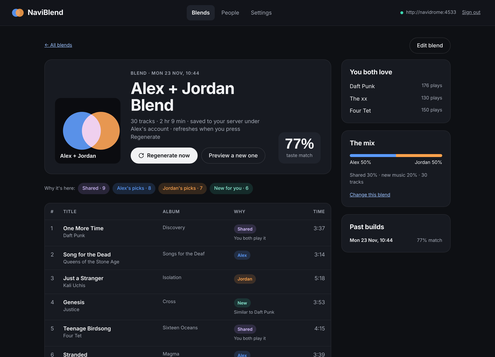
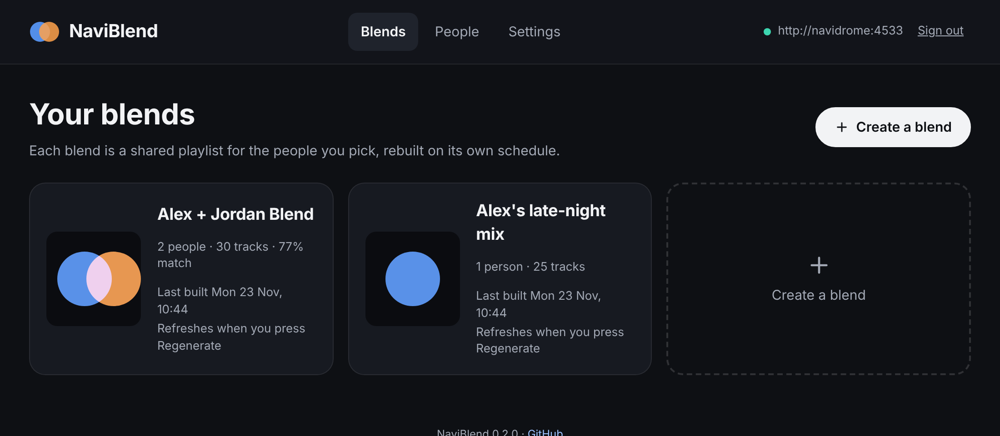
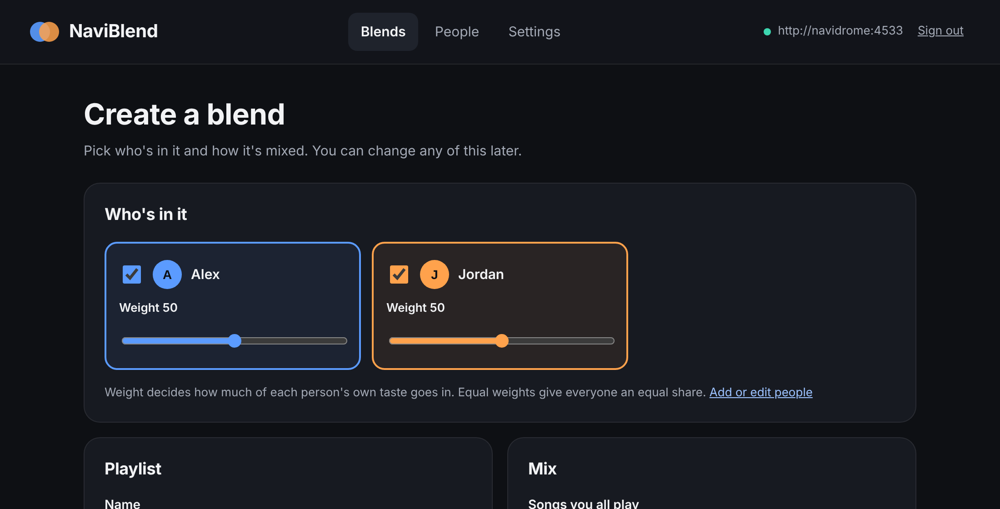

<p align="center"></p>

<h1 align="center">NaviBlend</h1>

<p align="center"><b>A Spotify-style Blend for Navidrome and other Subsonic servers.</b><br>
Mix two or more people's listening into one shared playlist that refreshes every week.</p>

<p align="center"></p>
<p align="center"> </p>

## What it does

Spotify's **Blend** is one of the things people miss most after moving to a self-hosted music server.
NaviBlend brings it to [Navidrome](https://www.navidrome.org/) (and Gonic, Ampache and anything else that speaks the Subsonic API):

- **As many blends as you like.** Add everyone once, then create blends for any mix of people: a couple's blend, a household blend, a solo late-night mix. Each blend is its own playlist with its own schedule.
- **Shared playlists saved straight to your server**, rebuilt on a schedule (weekly by default), so they show up in every app you already use.
- **Every track says why it's there**: songs you both play, each person's favourites, and new music from your library that none of you has played yet.
- **A taste-match score** and the artists you all love.
- **You choose the mix, per blend**: who's in it, how much each person counts, how much is shared or new, playlist length, refresh day and time.
- **Web interface** for setup and settings. No config files to edit.
- **Optional ListenBrainz and Last.fm history**, so listening from other apps counts too.

## Install

NaviBlend is one small container (or a Python app) with a web page on port **4545**. Pick whichever way suits you; they all end up at the same first-run screen.

> **Before you start:** NaviBlend needs to reach your music server's address, e.g. `http://192.168.1.10:4533` for Navidrome. If both run in Docker on the same network you can use the container name instead, e.g. `http://navidrome:4533`.

### 1. Docker Compose (recommended)

Create a folder, save this as `docker-compose.yml`, then run `docker compose up -d`:

```yaml
services:
  naviblend:
    image: ghcr.io/sragitprj/naviblend:latest
    container_name: naviblend
    restart: unless-stopped
    user: "1000:1000"            # match the owner of ./config (run `id` to check yours)
    ports:
      - "4545:4545"
    environment:
      - TZ=Europe/London         # so the weekly refresh runs at your local time
    volumes:
      - ./config:/config
```

Then open `http://<your-server>:4545`.

**Running Navidrome in the same compose file?** Add NaviBlend as another service and use `http://navidrome:4533` as the server address during setup.

### 2. Docker run

```sh
mkdir -p ~/naviblend
docker run -d --name naviblend --restart unless-stopped \
  --user "$(id -u):$(id -g)" \
  -p 4545:4545 -e TZ=Europe/London \
  -v ~/naviblend:/config \
  ghcr.io/sragitprj/naviblend:latest
```

### 3. Unraid

1. Download [`unraid/naviblend.xml`](unraid/naviblend.xml) and copy it to `/boot/config/plugins/dockerMan/templates-user/my-NaviBlend.xml`
   (from the Unraid terminal: `wget -O /boot/config/plugins/dockerMan/templates-user/my-NaviBlend.xml https://raw.githubusercontent.com/sragitprj/NaviBlend/main/unraid/naviblend.xml`).
2. Go to **Docker → Add Container**, choose **NaviBlend** from the *Template* list, check the time zone and click **Apply**.
3. Open the WebUI from the container's icon.

Or add it by hand: repository `ghcr.io/sragitprj/naviblend:latest`, port `4545`, path `/config` → `/mnt/user/appdata/naviblend`, extra parameter `--user 99:100`.

### 4. Portainer / other Docker UIs

Create a new **Stack**, paste the compose file from option 1 and deploy. Change `./config` to a full path such as `/opt/naviblend/config`.

### 5. Without Docker (Python 3.11+)

```sh
git clone https://github.com/sragitprj/NaviBlend.git
cd NaviBlend
python3 -m venv .venv && . .venv/bin/activate
pip install .
NAVIBLEND_DATA=./config naviblend      # http://localhost:4545
```

To keep it running, start it from a systemd service or `screen`/`tmux`.

### 6. Build the image yourself

```sh
git clone https://github.com/sragitprj/NaviBlend.git
cd NaviBlend
docker build -t naviblend .
```

Then use `naviblend` instead of `ghcr.io/sragitprj/naviblend:latest` in any of the options above.

### Updating

- **Compose:** `docker compose pull && docker compose up -d`
- **Docker run:** `docker pull ghcr.io/sragitprj/naviblend:latest`, then remove and re-create the container with the same command.
- **Unraid:** Docker tab → **Check for updates** → **Apply update**.
- **Python:** `git pull && pip install .`, then restart.

Your people, blends and history live in `/config`, so they survive updates. Back that folder up.

### Behind a reverse proxy

NaviBlend works behind Nginx Proxy Manager, Traefik, Caddy and others: point the proxy at port 4545. If your proxy already handles logins (Authelia, Authentik, etc.) you can turn off NaviBlend's own login with `NAVIBLEND_AUTH=none`.

### Troubleshooting

- **"No Subsonic server answered at that address".** Open `<address>/rest/ping` in a browser from the same machine. Inside Docker, `localhost` means the NaviBlend container itself, so use the server's IP or container name.
- **"Couldn't sign in as …".** Check the username and password work in a normal Subsonic app.
- **Permission denied on /config.** The `user:` value must own the config folder (`sudo chown -R 1000:1000 ./config`).
- **The refresh happens at the wrong time.** Set `TZ` to your time zone.

## First run

1. **Connect your server.** Enter its address and choose a password for the NaviBlend page.
2. **Add people.** Each person signs in with **their own** music-server account. That's how NaviBlend sees their personal play counts and favourites. Optionally add their ListenBrainz or Last.fm username.
3. **Create a blend.** Pick who's in it, set each person's weight, the mix and the schedule. Preview it first if you like, then build it. It appears on your server as a public playlist owned by whoever you choose.

## How the blend is made

For each person, NaviBlend reads their most played and recently played albums, their favourites, and (optionally) their ListenBrainz/Last.fm top tracks. It scores each song by play count, how recently it was played, and whether it's starred. Then it fills the playlist from three pools:

| Pool | Default share | What goes in |
|---|---|---|
| **Both** | 30% | Songs more than one person plays, then the top songs of artists you share |
| **Each person** | 50%, split by weight | Each person's highest-scoring songs |
| **New** | 20% | Songs in your library nobody has played, by artists similar to ones you like (uses your server's similar-artists data) |

Each artist is limited to a few tracks, the same artist never plays twice in a row where avoidable, and the pools are interleaved so the playlist alternates between everyone's tastes.

**Taste match** is the weighted overlap of the artists each of you listens to, shown as √overlap × 100 so that normal amounts of overlap don't all look tiny.

## Privacy and security

- Music-server passwords and the Last.fm key are **encrypted** in `/config/naviblend.db`. The key is in `/config/secret.key`, or in the `NAVIBLEND_SECRET_KEY` environment variable if you set one.
- NaviBlend only **reads** plays and favourites. The only thing it writes to your server is the blend playlist.
- The web page is protected by its own password. If NaviBlend sits behind an authenticating reverse proxy, you can set `NAVIBLEND_AUTH=none` instead.

## Configuration

| Variable | Default | |
|---|---|---|
| `PORT` | `4545` | Web interface port |
| `TZ` | `Etc/UTC` | Time zone for the schedule |
| `NAVIBLEND_DATA` | `/config` | Where settings and history are kept |
| `NAVIBLEND_SECRET_KEY` | *(generated)* | Fernet key used to encrypt stored passwords |
| `NAVIBLEND_AUTH` | | `none` disables the built-in login |
| `LOG_LEVEL` | `INFO` | |

## Roadmap

- [ ] Keep past weeks as separate playlists
- [ ] Fetch missing "new music" picks through Lidarr
- [ ] Cover art for the playlist

## Development

```sh
pip install -r requirements.txt pytest
python -m pytest            # uses an in-memory fake Subsonic server
python -m naviblend         # http://localhost:4545
```

## Licence

MIT. Not affiliated with Spotify or the Navidrome project.
